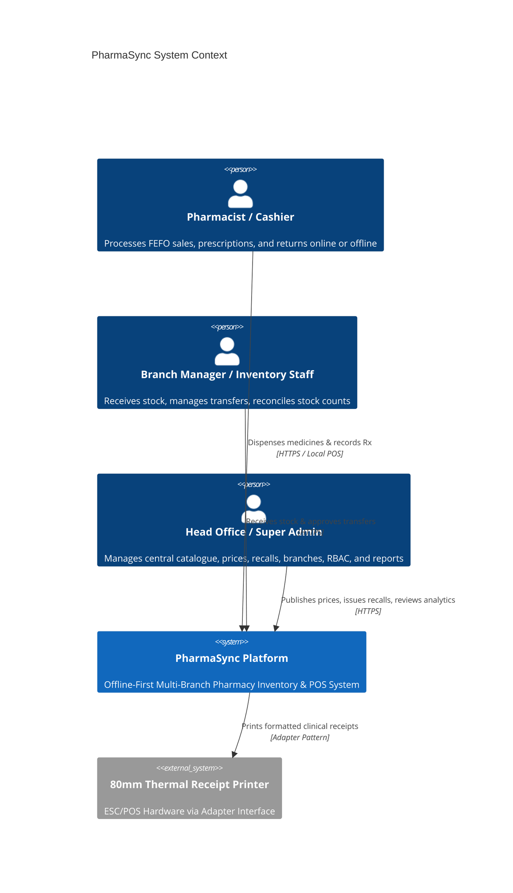
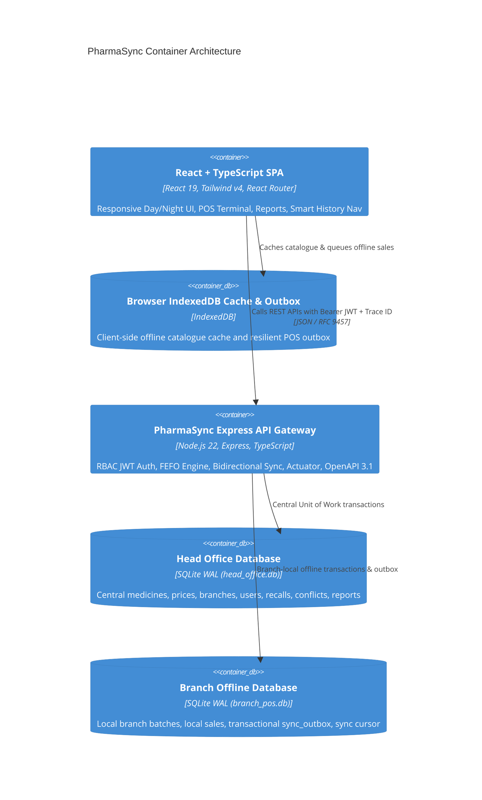
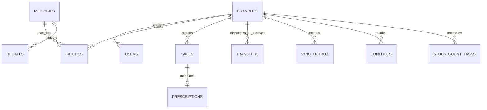

# PharmaSync Architecture Documentation

## 1. C4 Context Diagram

## 2. C4 Container Diagram

## 3. Database Entity-Relationship Diagram

## 4. Quality Attribute Utility Tree & Mini-ATAM Analysis

| Quality Attribute | Refinement | Scenario | Verification Target |
| :--- | :--- | :--- | :--- |
| **Availability / Offline Continuity** | 72-hour disconnected branch POS | Branch operates 72h offline with 5,000 sales and reconnects | **QA1**: 0 lost sales, 0 duplicates |
| **Data Consistency** | Multi-branch stock convergence | 3 branches sync concurrent sales, replays, price changes, and recalls | **QA2**: 100% stock convergence + recall block |
| **Performance** | POS checkout & scan latency | 5-item FEFO cart checkout + local barcode lookup | **QA3**: Checkout < 300ms p95, barcode < 50ms |
| **Clinical Safety** | Expiry & prescription compliance | Attempt to sell expired, recalled, or unrecorded Rx item | **QA4**: Strictly 0 violations |
| **Bandwidth Efficiency** | Low-bandwidth resumable sync | 800 daily sales pushed in resumable chunks at 256 kbps | **QA5**: Complete < 60 seconds |

### Mini-ATAM Trade-Offs & Sensitivity Points
- **Sensitivity Point 1 (Offline Recall Window)**: Blocking recalled batches requires the branch to receive the recall delta. *Mitigation*: Online branches sync immediately on recall issuance; offline branches detect post-recall timestamps deterministically upon reconnect (`POST_RECALL_SALE` critical conflict).
- **Trade-Off 1 (Eventual Consistency vs. Immediate Checkout)**: Strict central locks would break 72-hour offline availability. *Resolution*: Local SQLite/IndexedDB commits preserve availability while negative-stock conflicts automatically open physical stock-count tasks.

## 5. Required Design Patterns Justification Table

| Pattern | Implementation Location | Problem Solved |
| :--- | :--- | :--- |
| **Command Pattern** | `server/syncEngine.ts` (`SyncOpType` outbox payloads) | Encapsulates offline branch mutations (`SALE`, `RETURN`, `STOCK_RECEIPT`, `STOCK_COUNT`) with idempotency keys for replayable sync. |
| **Strategy Pattern** | `src/shared/domainEngine.ts` (`FefoBatchSelectionStrategy`, `calculateReorderSuggestion`) | Isolates interchangeable FEFO dispensing and velocity reorder algorithms cleanly for unit testing. |
| **State Pattern** | `src/shared/domainEngine.ts` (`assertTransferTransition`) | Enforces legal inter-branch transfer lifecycle (`DISPATCHED -> IN_TRANSIT -> RECEIVED`) and prevents illegal state skips. |
| **Composite Pattern** | `src/shared/domainEngine.ts` (`BoxPack`, `StripPack`, `TabletUnit`) | Uniformly converts hierarchical pharmacy packaging (`box -> strip -> tablet`) into base inventory units. |
| **Observer Pattern** | `src/shared/domainEngine.ts` (`DomainEventBus`) | Decouples sale completion, recall issuance, transfer updates, and conflict detection from downstream subscribers. |
| **Repository Pattern** | `server/db.ts` (`mapMedicineRow`, `mapBatchRow`, `mapBranchRow`) | Separates relational SQLite row schemas from domain entities across Head Office and Branch databases. |
| **Unit of Work** | `server/db.ts` (`runHeadOfficeTx`, `runBranchTx`) | Guarantees atomic stock deduction + sale insert + transactional outbox append inside a single SQLite `BEGIN IMMEDIATE` transaction. |
| **Adapter Pattern** | `src/shared/domainEngine.ts` (`ThermalReceiptPrinterAdapter`) | Decouples POS receipt formatting from physical 80mm ESC/POS hardware drivers. |
